# Sharley architecture

Sharley is an independent verifier for AI-written code. It turns any input into a requirement-tagged test bank, lets the
implementing agent see only a small share of it, and judges the result against sealed hidden tests in a sandbox.
The board (`web/`) is only a window; the product is the verifier, the CLI/merge gate and the agents.

## 1. Components: inputs, outputs, what each does

```mermaid
flowchart LR
  subgraph IN["1. Inputs"]
    T["One-line idea or huge spec<br/>(text)"]
    P["Photo or webcam shot of a whiteboard<br/>(JPEG / PNG)"]
    R["GitHub repo URL or local codebase"]
  end

  subgraph INTAKE["2. Intake  (sharley/intake)"]
    N1["Normalize<br/>text: as is<br/>image: vision model describes it<br/>repo: plain-code parser lists routes,<br/>request bodies, schemas, env vars, Dockerfile"]
    N2["Chunk if over 12k chars<br/>extract chunks in parallel, merge in order"]
    N3["Extract atomic requirements R1..Rn<br/>drawn = verbatim quote from input<br/>assumed = explicit assumption A1..An"]
    N4["Coverage check<br/>every sentence maps to a requirement<br/>or is ignored with a reason"]
    SPEC[("spec.json<br/>frozen, hashed")]
  end

  subgraph GEN["3. Test generation  (planner, generator)"]
    PL["Planner (plain code)<br/>3 requirements per task<br/>family by category"]
    Q[("Task queue<br/>MongoDB or JSON")]
    W["8 parallel writers (LLM)<br/>functional QA writer<br/>security writer<br/>env check is plain code"]
    TR["Traceability gate<br/>every Rn needs a test<br/>else the bank is refused"]
    SP["Seeded split<br/>about 30 percent examples<br/>about 70 percent sealed"]
  end

  subgraph STORE["4. Where tests live"]
    EX["Example tests (visible)"]
    SE[("Sealed bank<br/>server only, hashed<br/>never sent to a browser")]
  end

  subgraph IMPL["5. Implementer (any coding agent)"]
    ZIP["Project zip<br/>SPEC.md, spec.json, example tests,<br/>sharley.yaml, CLAUDE.md, prompt, photo"]
    CC["Claude Code or any agent<br/>builds the service"]
  end

  subgraph JUDGE["6. Judge  (sharley/judge, runner)"]
    TA["Tamper check<br/>hash every example test<br/>edited, deleted or skipped = Rejected"]
    CL["Clean copy<br/>strip planted conftest and pytest config"]
    SB["Docker sandbox<br/>no network, read-only root,<br/>app runs as nobody, tests unreadable to it,<br/>results printed by a root harness<br/>the app cannot write to"]
    VD["Verdict<br/>Accepted / Wrong Answer on sealed test N of M<br/>Runtime Error / Time Limit / Build Failed / Rejected<br/>plus a plain-English hint, both model families, seed, spec hash"]
  end

  subgraph SURF["7. Surfaces"]
    CLI["sharley check / watch<br/>GitHub Action merge gate<br/>auto revert PR"]
    API["HTTP + SSE API<br/>public-mode guard, rate limit"]
    BD["Board: Playground, GitHub repo, Intake, Judge, Eval"]
    AG["Fetch.ai agents<br/>Intake, Test Author, Judge"]
  end

  subgraph EVAL["8. Proof the tests have teeth  (mutation, skills)"]
    MU["Mutation engine<br/>off-by-one, flipped conditions,<br/>dropped validation, wrong status,<br/>removed auth, string-built SQL,<br/>missing ownership, leaked traces,<br/>disabled rate limit"]
    GR["Graders<br/>held-out mutation score<br/>false-failure rate<br/>security kill rate"]
    SK["Skill loop<br/>reflect on TRAIN survivors only<br/>candidate rule, score on HELD-OUT mutants<br/>adopt or roll back, every version logged"]
  end

  subgraph MODELS["Models and spend"]
    PR["Provider chain<br/>strong steps: Meta, then Claude, then local<br/>small steps: Claude first<br/>typed step runner: validate, retry, escalate"]
    BG["Spend ledger with hard cap"]
  end

  T --> N1
  P --> N1
  R --> N1
  N1 --> N2 --> N3 --> N4 --> SPEC
  SPEC --> PL --> Q --> W --> TR --> SP
  SP --> EX
  SP --> SE
  EX --> ZIP --> CC
  CC -->|"submission (code)"| TA
  SE --> SB
  TA --> CL --> SB --> VD
  VD --> CLI
  VD --> API
  API --> BD
  VD --> AG
  W -. "generated tests under skill rules" .-> MU
  MU --> GR --> SK
  SK -. "adopted rules go into every writer prompt" .-> W
  PR -. "used by" .-> N1
  PR -. "used by" .-> N3
  PR -. "used by" .-> W
  BG -. "meters" .-> PR
```

## 2. How the security and QA tests are run

| Kind | Who writes it | What it checks | How it runs |
|---|---|---|---|
| Functional QA | LLM writer (verifier family) | happy paths, boundaries, error handling, state changes, idempotency | pytest + httpx over HTTP against the booted app |
| Security | LLM writer, prompted for injection (SQL, command), broken auth and access control, IDOR, input validation, secrets exposure, rate limiting, forged tokens | the app must reject what the spec forbids | same, inside the network-less sandbox |
| Env and boot | plain code, no model | every env var read in code is declared; app boots; `/health` returns 200 | generated from the code scan |
| Mutation (our proof) | plain code | tests must fail on deliberately broken copies of a correct app, and pass on the correct one | the same sandbox, per mutant |

Whisper / speech is not used and not built. Voice could be added in front of Intake (speech to text, then the same pipeline).

## 3. How tokens flow

| Step | Model tier | Sees | Size bound |
|---|---|---|---|
| Describe image | strong (Meta first) | the image only | 1 call |
| Extract requirements | strong | one chunk of text (max 12k chars) or the code summary | one call per chunk, chunks in parallel |
| Coverage check | small (Claude first) | only the sentences not already quoted by a requirement | 1 call |
| Write tests | strong | 3 requirements verbatim, the app's route/body/error surface (max 8k chars), the original spec excerpt (max 6k chars), adopted skill rules | about N/3 calls, 8 in parallel |
| Reflect (skill loop) | strong | up to 12 TRAIN survivors, never held-out | 1 call per iteration |
| Everything else | none | planning, splitting, hashing, tamper check, sandbox runs, parsing results, mutation, scoring, env checks | zero tokens |

Why this gets vibecoded apps to production sooner: the expensive human step (writing and reviewing tests) becomes about a dozen small parallel model calls,
and everything that decides pass or fail is deterministic code, so a verdict takes seconds and is reproducible (seeded split, spec hash, both model versions recorded).

## 4. One sentence or a huge prompt

- **One sentence:** most requirements are inferred, so each carries an explicit assumption id. A requirement only counts as drawn if its quoted span really appears in the input; otherwise it is downgraded to assumed.
- **Huge input:** a repo is reduced by plain code to routes, request bodies, schemas and env vars (capped lists), not pasted whole. Long text is split on line boundaries, extracted in parallel and merged in order. A long-context model (SubQ) is wired as an optional single pass but has not been exercised.
- **Every later step reads exact requirement text from `spec.json`, never a summary**, and gets only the slice it needs.

## 4b. Why the tests make the coding agent imaginative

The agent sees a few examples; the rest are sealed, hash-checked and unreadable from the sandbox. It cannot edit, skip or delete tests (tamper check),
cannot read them, and cannot forge results (the harness runs as a different user than the app). The only way to pass is to implement the behaviour the spec describes.
The verifier is a different model family than the implementer, so it does not share the implementer's blind spots.
